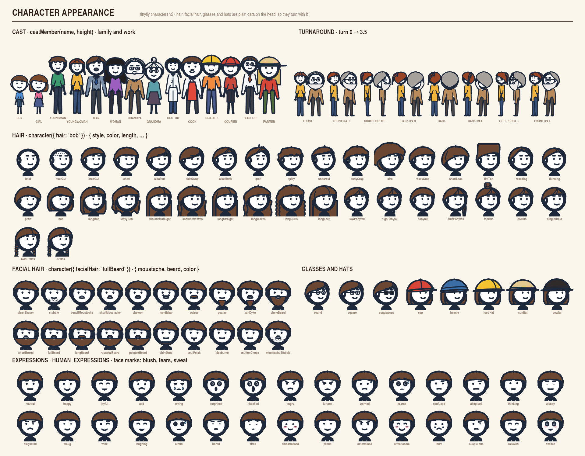

# Character Appearance

Hair, facial hair, glasses, hats, ears, builds, a ready-made cast, held items,
meeting hands and hair that swings for the v2 character (`character()` in `@algorisys/tinyfly/characters`). Every choice
is plain data, so a character can be saved, synced, generated by a language
model and changed one field at a time.



The sheet is drawn by `examples/headless-video/appearance-sheet.mjs`
(`npx tinyfly video examples/headless-video/appearance-sheet.mjs --stills stills/`).

## Quick start

```js
import { character, characterTarget, drawCharacter, humanPose, castMember, HUMAN_EXPRESSIONS } from '@algorisys/tinyfly/characters'

// Pick everything by name…
const maya = character({
  height: 300,
  build: 'slim',
  hair: { style: 'highPonytail', color: '#9a4426' },
  glasses: 'round',
  ears: true,
  outfit: { shirt: '#f0b43c', trousers: '#36507a' },
})

// …or start from the cast and change what you like.
const grandpa = character(castMember('grandpa', 300, { look: 'pencil' }))

// Faces are pose fields, so any expression goes with any action and view.
drawCharacter(ctx, maya, humanPose({ ...HUMAN_EXPRESSIONS.embarrassed, turn: 0.5 }))
```

A plain figure (no `hair`, `facialHair`, `glasses`, `hat` or `ears`) draws
exactly as it did before these options existed.

## Organic cartoon bodies

Use `figure: 'organic'` for original, softly drawn story characters. The
existing human skeleton controls poses, reaching, ground contact and part
order. Filled contours supply shoulders, chest, waist, hips and shaped
limbs; dimensions are independent of the outline width.

```js
import { character, softCartoonCharacter, characterScript, hairFollowTracks } from '@algorisys/tinyfly/characters'

const actor = character({
  figure: 'organic', height: 320, skin: '#efbd96',
  body: {
    arm: [{ at: 0, width: 0.028 }, { at: 0.5, width: 0.018 },
          { at: 0.7, width: 0.023 }, { at: 1, width: 0.012 }],
    outline: { color: '#53372d', width: 1.5 },
    shading: { mode: 'cel', light: [-0.8, -0.6], opacity: 0.17 },
  },
  face: { style: 'anime', shape: 'angular', jawRoundness: 1 },
  hair: { style: 'flowingBob', color: '#38291f' },
  outfit: { shirt: '#72958b', trousers: '#495a67' },
})
const friend = softCartoonCharacter('youngWoman', { height: 300 })
const story = characterScript('actor', actor, [
  { do: 'walk', to: 240, for: 2200 },
  { do: 'say', say: 'Let us explore!', for: 1800, mood: 'happy' },
], { from: 60 })
story.tracks.push(...hairFollowTracks('actor', story.tracks, actor))
```

`softCartoonCharacter` accepts only `youngMan`, `youngWoman`, `childBoy`
and `childGirl`; unknown actor names throw an error, including inherited
object keys such as `constructor`.

`body.torso`, `arm`, `leg` and `neck` are arrays of `{ at, width }`.
`at` increases from 0 to 1; `width` is a half-width fraction of character
height. Torso positions run hip to neck, arms shoulder to wrist, and legs
hip to ankle. Cubic centerlines pass through native elbow/knee joints with
interpolated width profiles. Options are copied at construction and can
travel as JSON. `body.depth` (0.2–1, default 0.55) sets torso side thickness.
`body.fill` overrides `skin` for all exposed body, face and palms; omit it
to keep one `skin` colour control. The editor's Skin and Line controls show
the resolved fill and outline colour; editing them also updates any existing
`body.fill` or `body.outline.color` override without changing other body options.

Default organic hands are small natural five-finger hands (`handSize: 0.073`).
Existing `hand.left.*` / `hand.right.*` tracks control palms, fists, pointing,
bends and wrist rolls. Foreground organic arms and hands draw together after
the torso and lower garments; rear arms remain behind them. Attached borders at shoulders, hips, wrists and ankles are hidden
where connected contours meet. This ordering also survives the 3D scene's
global depth sort, while separate world objects can still occlude the figure.
`characterPartsInView()` retains each part's physical `depth` and supplies
an organic `sortDepth` for painter ordering. Only foreground arms are promoted
to the nearest torso/leg garment depth; head, neck, torso, legs and rear arms
keep their physical depths. Scene integrations sort by `sortDepth ?? depth`, retaining array
order for ties. Fluid and stick parts retain their existing depth ordering.

Organic faces default to `face.projection: 'volume'`: feature centres follow
the head's 3D axes, both eyes stay readable in three-quarter views, the far
eye narrows toward profile, and opaque hair covers
eyes and brows. Features stay clipped inside the head through turns and nods.
The facial plane is flatter than the rounded rear cranium in profile.
With `face.nose: true`, a small nose projects from above the mouth and shapes
the turned silhouette without extending the chin.
`projection: 'cartoon'` retains the classic face slide used by fluid/stick.

Cel shading is clipped to moving skin in the clean look. `body.shading`
accepts `mode: 'cel' | 'none'`, screen-space `light: [x, y]`, `shadow`,
`opacity` and `highlight`. Seeking and headless rendering are deterministic.
Pencil and silhouette use their existing pens. Artist-authored painted
meshes remain a separate future capability.

Set `body.fill: 'none'` (or `skin: 'none'` without a body fill override) for
outline-only exposed body, head and hands in every look. Dot and articulated
hands omit skin fills and shading; clothing retains its own material.

Everyday shirts, sleeves, trousers, shorts and skirts follow organic anatomy.
`leafOutfit: { top: true, color: '#638c39', accent: '#87ae4e', length: 0.32 }`
selects attached leaf garments with curved shapes and veins; `top: false`
leaves the upper body uncovered. It requires organic mode.
`leafOutfitContours(joints, options)` exposes plain coverage geometry for
custom layers and exporters. Both wardrobes use native part depths.

`softCartoonCharacter('childBoy')` and `softCartoonCharacter('childGirl')`
provide original child presets with a larger head/body ratio, shorter arms
and legs, rounded torsos and smaller default heights (230 and 225 px).
All face, hair, clothes, skin and proportions remain editable; changing
`height` preserves the child anatomy. The same pose, script, hand, reaching
and lip-sync APIs work for adults and children.

The example at `/examples/live-organic-characters` includes adult, child and
adult/child pairs, face/hair
choices, independently editable everyday/formal/casual/leaf garments, seven actions, outline and skin controls,
shading, playback and scrubbing. Available in v0.108.0. See the
[contact sheet](model-sheet/organic-characters.png) and
[child character sheet](model-sheet/child-characters.png).
Close-up [head turns](model-sheet/organic-head-turns.png) exercise independent
`head.turn` at the story's body orientation.
`fluid` and `stick` keep their existing defaults and ink-based dimensions.

## Everyday, Formal and Casual clothing

`outfitPreset(category, overrides)` returns fresh plain JSON options for
`character({ outfit })` or `softCartoonCharacter(name, { outfit })`.
The categories are `everyday`, `formal` and `casual`. Every garment works
with adult and child actors, regardless of gender.

```js
import { softCartoonCharacter, outfitPreset } from '@algorisys/tinyfly/characters'

const formal = softCartoonCharacter('youngMan', {
  outfit: outfitPreset('formal', { shirt: '#ece6db', trousers: '#354456', tie: '#7b3955' }),
})
const casual = softCartoonCharacter('youngWoman', {
  outfit: outfitPreset('casual', { top: 'tshirt', bottom: 'shorts', trouserStyle: 'cargo' }),
})
const dress = softCartoonCharacter('childGirl', {
  outfit: outfitPreset('formal', { top: 'dress', shirt: '#aa6b91', sleeves: 'none' }),
})
```

- `top`: `tshirt`, `shirt` (button placket), `blouse` (V neckline) or `dress`.
  Omit it to retain the original plain T-shirt. Shirts default to a collar;
  an explicit `collar: false` removes it.
- `bottom`: `trousers`, `shorts` or `skirt`; `trouserStyle`: `plain`, `jeans`
  (pockets and stitching) or `cargo` (thigh pockets). Details follow the
  limbs and stay clipped inside the fabric.
- `shirt` and `trousers` remain top and bottom colours. A dress uses
  `shirt` for both its bodice and skirt, overriding `bottom` and ignoring
  the separate bottom colour. `sleeves` accepts `short`, `long` or `none`.
- `collar` is a boolean; `tie` is a colour or `null` to remove it. Changing a
  formal preset to a different top removes its default collar and tie;
  explicit accessory overrides take precedence.

The example's **Edit outfit** choice edits both characters or either actor
separately. Formal starts with a shirt/tie or blouse/skirt; Casual starts
with a T-shirt/jeans. All cuts remain selectable for either character.
The editor exposes the same presets and garment choices, saved with scene
JSON. [Clothing sheet](model-sheet/clothing-options.png), reproduced by
`examples/headless-video/clothing-options.mjs`.

## How it turns

Hair, beards and hats are not flat drawings pasted on the face. Each is a
region on the head's surface (where the hairline runs, how far the hair stands
off the head, how far it hangs), drawn wherever the head's `turn`, `head.turn`,
`head.nod` and `head.tilt` put it:

- the part facing away is drawn before the body, so long hair hangs behind the
  shoulders seen from the front, and a bob shows beside the face;
- the part facing the viewer is drawn over the head, so a fringe crosses the
  forehead and, from behind, the hair covers the whole head;
- in a whole-figure 2D draw, turned away (past about `turn` 1.2), hair is
  drawn after the body, over an arm at the side;
- in a camera-sorted 3D scene, rear hair and hats draw with the head's own
  part, after its skin. They remain attached through independent head turns
  and nods, without another body's draw order exposing the scalp;
- a parting, a side ponytail or a braid stays on the character's own side
  through a turn: left and right are the character's, never mirrored.

Glasses, moustaches and the face marks sit on the face itself, placed like the
eyes and mouth, so they slide round with the face and hide with it.

**Which part wins where two overlap** is fixed: eyes and brows draw over a
fringe; the mouth draws over a beard, which leaves an opening for it (so every
lip-sync shape stays readable); a moustache draws over the top of the mouth;
glasses over the eyes; a hat over the hair. Ears are hidden by hair that
`coversEars`.

## Views

`turn` runs 0 → 4. The eight reference views:

| View | `turn` |
|---|---|
| Front | 0 |
| Front 3/4 right (nose toward screen right) | 0.5 |
| Right profile | 1 |
| Back 3/4 right | 1.5 |
| Back | 2 |
| Back 3/4 left | 2.5 |
| Left profile | 3 |
| Front 3/4 left | 3.5 |

The view names describe the screen; limb and side names (`arm.left`,
`at: 'left'`) are always the character's own.

## Hair

`hair` takes a style name, a style with changes, or `null`:

```js
character({ hair: 'bob' })
character({ hair: { style: 'bob', color: HAIR_COLORS.auburn, length: 1.4 } })
character({ hair: { volume: 0.2, hairline: { front: 0.3 }, ties: [{ kind: 'bun', at: 'top' }] } })
```

Short cuts and hairlines: `bald`, `buzzCut`, `crewCut`, `short`, `sidePart`,
`sideSwept`, `slickBack`, `quiff`, `spiky`, `undercut`, `curlyCrop`, `afro`,
`wavyCrop`, `shortLocs`, `flatTop`, `receding`, `thinning`.

Medium and long hair: `pixie`, `bob`, `longBob`, `wavyBob`, `shoulderStraight`,
`shoulderWaves`, `longStraight`, `longWaves`, `longCurls`, `longLocs`,
`lowPonytail`, `highPonytail`, `ponytail`, `sidePonytail`, `topBun`, `lowBun`,
`singleBraid`, `twinBraids`, `braids`.

Flowing cartoon hair: `softSweep`, `flowingBob`, `cascadingWaves`. These use
broad curved locks over a fitted scalp cap, with soft tapered ends and gentle
asymmetry. The bob and long waves include a narrowing supporting mass so the
locks overlap without gaps. Each description serves every head angle.

Every style is the same few fields (`resolveHair(spec)` fills them all in):

| Field | Meaning |
|---|---|
| `color` | Fill colour. `HAIR_COLORS` has `black`, `brown`, `chestnut`, `auburn`, `blond`, `ginger`, `gray`, `white` |
| `volume` | How far the hair stands off the head (head radii) |
| `hairline` | `{ front, side, back }`: its height at the forehead, temples and nape (head radii, +up from the head's centre) |
| `sweep` | A side fringe: the hairline drops toward the character's left (+) or right (−) |
| `recede` | Temples pushed back |
| `length` | Long hair: where it ends, head radii below the head's centre (`0` short; about 1.75 is the shoulders) |
| `opening` | Long hair: half the opening left for the face, degrees |
| `texture`, `textureAmount` | `smooth`, `spiky`, `curly`, `wavy` or `locs`, and how strong |
| `quiff`, `flat` | Volume swept up over the forehead; a flat top's height |
| `part`, `strands` | A parting (degrees round from the middle of the face) and the detail lines: `none`, `part`, `sweep`, `combed`, `hanging`, `thin` |
| `fill` | `solid`, or `stipple` (close-cropped: dots on the scalp) |
| `ties` | Ponytails, buns and braids: `{ kind: 'ponytail' \| 'bun' \| 'braid', at: 'top' \| 'high' \| 'low' \| 'left' \| 'right', length?, size? }` |
| `locks` | Curved sections: `{ path, width, follow? }`; `width` is in head radii; `follow` scales their flex (default 1, 0 pins a lock) |
| `fall` | Hanging mass: `{ taper, wave }`, narrowing toward the ends (0..1 head radii) and a soft uneven hem (nonnegative head radii) |
| `shine` | Soft highlight opacity on the locks, 0..1 (default 0); drawn in the clean look |
| `coversEars` | The hair hides the ears |

A style stays a starting point: any style suits anyone.

A lock's `path` has a root, two controls and a tip for a cubic curve; append
groups of three points for additional segments. Each point is
`{ around, up, lift? }`: `around` is degrees from the face toward the character's
left, `up` is head radii from the centre (at most 1), and nonnegative `lift`
adds distance outside the cap. The root must have `up` between 0 and 1 and no
extra lift. Sweeps follow the scalp rather than cutting through the skull.
Use continuous angles across the back, such as 160, 190, 220. Invalid lock
paths, widths, flexibility, shine and fall values throw during `resolveHair`.

```js
const hair = resolveHair({ style: 'cascadingWaves', color: '#985b32' })
// Edit the resolved data; presets and other characters keep their own paths.
hair.locks[0].follow = 0.65
character({ hair })
// Remove the sculpted locks, keeping the cap and supporting mass:
character({ hair: { style: 'flowingBob', locks: [], shine: 0 } })
```

`length` changes the supporting mass; edit lock path points to change their
individual lengths and curls. Public types: `HairLock`, `HairLockPoint`.
See the **Flowing Cartoon Hair** example and the
[eight-view reference sheet](model-sheet/flowing-hair.png).

## Hair in motion

Hair that hangs (long hair, ponytails, braids) lags behind the head: it swings
round after a turn, streams back on a run, drops on a jump and lifts on the
landing. The roots stay on the head; the ends move, more the further they hang.
Ordinary short hair, buns, beards and hats stay put. Flowing locks also flex,
including the short `softSweep`: their roots remain fixed while their ends
respond by each lock's `follow` amount. The presets use smaller amounts on
the fringe and larger, varied amounts on the hanging locks.

The lag is three pose fields, so it keys, saves and mirrors like any other:

| Field | Meaning |
|---|---|
| `hair.swing` | Swung round the head toward the character's left (+) or right (−), degrees |
| `hair.trail` | Streaming back behind the head (+) or thrown forward (−), head radii |
| `hair.lift` | Lifted (+) or dropped (−), head radii |

You rarely set them by hand. `hairFollowTracks` works them out from the
character's own tracks (the target's `x` and `y`, the pose's `turn` and
`head.turn`), each on a spring that chases the head, the way a prop's `follow`
trails a car's antenna or a dog's tail:

```js
const tracks = characterPoseTracks('maya', keys)
tracks.push(...hairFollowTracks('maya', tracks, maya))
// Nothing is added for hair with nothing to swing. A `hair.swing` track written
// by hand (a flick) keeps its values, with the lag added on.
```

Code that poses a character every frame keys the lag once for its loop, then
reads it at each frame's time:

```js
const lag = hairFollow((t) => ({ x: xAt(t), y: yAt(t), turn: turnAt(t) }), { end: 8000, headRadius: 24 })
drawCharacter(ctx, maya, humanPose({ turn: turnAt(t), ...hairMotionAt(lag, t) }), t)
```

`hairFollow` options: `stiffness` (default 70, higher follows the head more
tightly), `damping` (6, lower swings longer), `amount` (1; 0 pins the hair) and
`step` (33 ms between keys). `hairFollowTracks` also takes `settle`, how long
the hair keeps moving after the last key (1500 ms). The springs step in fixed
1 ms steps, so the same motion always gives the same keys, and the drawing
itself keeps no state between frames.

Four-legged animals get the same treatment for free: their `ears` control
(pricked forward +, laid back −) and `tail` both trail the animal's motion on a
spring in every `propScript`.

## Facial hair

`facialHair` takes a style name or `{ moustache, beard, color }` (the colour
defaults to the hair's):

`cleanShaven`, `stubble`, `pencilMoustache`, `shortMoustache`, `chevron`,
`handlebar`, `walrus`, `goatee`, `vanDyke`, `circleBeard`, `shortBoxed`,
`fullBeard`, `longBeard`, `roundedBeard`, `pointedBeard`, `chinStrap`,
`soulPatch`, `sideburns`, `muttonChops`, `moustacheStubble`.

Moustaches: `none`, `pencil`, `short`, `chevron`, `handlebar`, `walrus`.
Beards: `none`, `stubble`, `goatee`, `soulPatch`, `chinStrap`, `circle`,
`boxed`, `full`, `rounded`, `pointed`, `long`, `sideburns`, `muttonChops`.

## Glasses, hats and ears

- `glasses`: `round`, `square`, `sunglasses` (drawn in the ink; the near arm
  runs back to the ear in profile).
- `hat`: `cap`, `beanie`, `hardHat`, `sunHat`, `bowler`, or `{ style, color }`.
  The crown sits over the hair; hair below the brim still shows.
- `ears: true` adds ears: they stick out past the head from the front and
  behind, and sit on the head with a curl when turned toward the viewer.
- `face: { teeth: true, tongue: true }` shows a row of upper teeth hanging
  from the top of the mouth, and a tongue lying in the bottom of it, whenever
  the mouth opens past 0.3 (a laugh, a shout, a wail). The mouth's shape is
  still the pose's `mouth`, `smile` and `mouthWidth`; a closed or barely open
  mouth shows neither. Default: neither, so a plain face draws as before.

## Builds

`build` sets proportions; `height` sets how tall the character stands. Any
field can still be set on its own (`headSize`, `shoulderWidth`, `hipWidth`,
`legLength`, `armLength`).

| Build | What changes |
|---|---|
| `standard` | Nothing |
| `slim` | Smaller head, narrower |
| `tall` | Smaller head, longer legs and arms |
| `short` | Larger head, shorter legs, a little wider |
| `broad`, `curvy`, `stocky` | Shoulder and hip widths (stocky: a larger head) |
| `kid`, `child`, `toddler` | Larger head, shorter limbs |

`feet` sets the feet's shape: `round` (the default blob), `flat` (a shoe,
longer and even), `pointed` (a slipper, tapering to the toe) or `big` (clown's
feet, half as long again and wide). The shape is clearest in profile, where
the foot points along the ground; from the front it points at the viewer.

Age, posture and accessories are separate choices: a child build is only
proportions, and an older character is shown by hair and glasses, never by a
stoop unless one is posed. A cane (`holding: { right: 'cane' }`) and a
wheelchair (the `wheelchair()` prop, ridden in the `wheeling` pose) are
accessories any character can have, not part of an age. The same poses, gaits and actions work on every
build; `humanGaitStrideLength(gait, height, stride, legLength)` gives a build's
stride so its feet stay planted.

## Clothes

`outfit` dresses the character as data (any `layers` are drawn over it):

```js
character({ outfit: { shirt: '#7a8fa6', trousers: '#3b3f46', sleeves: 'long', collar: true, tie: '#2b4f8c' } })
character({ outfit: { bottom: 'skirt' } })
character({ outfit: { over: 'labCoat' } })
```

| Field | Choices |
|---|---|
| `shirt`, `trousers` | Colours (the trousers' colour also colours shorts and a skirt) |
| `sleeves` | `short` (default), `long`, `none` |
| `bottom` | `trousers` (default), `shorts`, `skirt` |
| `collar` | `true` for a shirt collar |
| `tie` | A colour, for a tie down the front |
| `over`, `overColor` | `apron`, `labCoat`, `hoodie` (a loose top with a hood at the back, a front pocket and long sleeves), `cardigan` (open down the front, buttoned), `overalls` (a bib with straps, in the trousers' colour) or `sari` (a drape to the ankles with the pallu over the near shoulder), and its colour |
| `shoes`, `shoeColor` | `boots` to above the ankle, and their colour |

The front details (collar, tie, apron, the coat's opening) show from the
front and turn away with the body; from behind an apron shows its ties.
`basicOutfit(options)` gives the same clothes as layers.

Tops keep the upper thighs and trouser roots behind their hem through turns
and moving poses. The waist makes room for wider hips. Skirts, sari drapes,
aprons and coat skirts follow the body's resolved drawing order, including
camera views and rendering the character part by part.

Custom `layers.parts[id].clip(ctx, joints, pen, time, pose)` can clip the bare
body part before it draws. Set the canvas clipping path in this hook; it is
restored before the part's `over` layers and the next part. The built-in outfit
uses this to hide thighs under tops. `joints.parts[id].order` is the resolved
far-to-near drawing index; use it when a garment spans several parts.
Camera-projected joints also provide `bodyForward: [x,y,z]` in view space:
`z` is front visibility and `x` is the side offset for front details. This
axis follows the body and camera independently of head yaw. `joints.turn`
retains the authored body turn; flat drawing omits `bodyForward`, so use
`cos(turn * Math.PI / 2)` and `sin(turn * Math.PI / 2)` there.
The built-in wardrobe uses this direction for front buttons, necklines,
pockets, collars, ties and outer-garment details.

## The cast

`castMember(name, height, changes?)` returns character options for a recurring
cast member at an adult `height` (each stands at their own scale of it). The
family: `boy`, `girl`, `youngMan`, `youngWoman`, `man`, `woman`, `grandpa`,
`grandma`; at work (from the occupations sheet): `doctor`, `cook`, `builder`,
`courier`, `teacher`, `farmer`. `CHARACTER_CAST` has each one's `label`,
`group` (`family`, `work`, `anime` or `manga`), `scale` and `options`.

```js
const family = ['man', 'woman', 'girl', 'grandma'].map((name) => character(castMember(name, 280)))
```

### Colour anime cast

`ANIME_CAST` contains eight editable presets, also included in `CHARACTER_CAST`:
`animeBoy`, `animeGirl`, `animeYoungMan`, `animeYoungWoman`, `animeMan`,
`animeWoman`, `animeOlderMan`, and `animeOlderWoman`. Children use shorter
limbs and a larger head; older adults use grey hair and subtle face creases.
All presets use the same human rig, so existing expressions, acting,
hand gestures, gaits, dance, and full head/body turns work with them.
The looks are starting points: any hair, outfit, iris colour or build can be changed.

```js
const young = character(castMember('animeYoungWoman', 300))
drawCharacter(ctx, young, humanPose({ ...HUMAN_EXPRESSIONS.surprised, turn: 0.5 }))
const older = character(castMember('animeOlderMan', 300, {
  face: { style: 'anime', iris: '#94713e', lashes: false, ageLines: 0.6 }
}))
```

For any character, `face: { style: 'anime' }` draws almond-shaped eyes with
coloured irises and highlights. `iris` sets their colour (default `#4b7fce`),
`lashes` enables outer lashes (default true), and `ageLines` sets subtle eye
and smile creases from 0 to 1 (default 0). `style: 'simple'` is the original
face and remains the default. Face style is separate from the pen's `look`
(`clean`, `pencil`, or `silhouette`); `look: 'anime'` is not a pen style.

The existing `eye.left`, `eye.right`, `blink`, `lookX`, `lookY`, `pupil`, `lid`,
`bulge`, brows and mouth fields animate both styles. The coloured eye opening
narrows with the lids; blink or a fully lowered lid closes it. Far-side eyes
hide in profile and all face features hide from behind. The style and colours
are plain JSON; `face.inPupil` remains an optional drawing hook for custom content.
`castMember` changes replace option objects such as `face` or `outfit` as a whole.

The **Colour Anime Cast** example shows all eight presets, expressions,
face close-ups and a complete turnaround. Both the Character and 3D Scene
editors offer these presets in their Cast picker. The Character editor also
has Face style, Iris colour, Eyelashes and Age creases controls, saved in project JSON.

### Young adult manga cast

`MANGA_CAST` supplies four original archetypes: `mangaYoungMan`,
`mangaYoungWoman`, `mangaRival`, and `mangaHeroine`. They also belong to
`CHARACTER_CAST` and use the shared expression, pose, dance and turnaround APIs.
These presets use lighter line widths, angular jaws and smaller, narrower eyes.
Hair, skin, clothing and every face option remain editable.

```js
const preset = MANGA_CAST.mangaYoungMan.options
const hero = character(castMember('mangaYoungMan', 300, {
  hair: { style: 'bob', color: '#446688' },
  face: { ...preset.face, jawWidth: 0.8, chinWidth: 0.12, iris: '#987546' }
}))
```

`face.shape: 'angular'` changes the pen character's head outline into a
projected 3D tapered head, following yaw, nod and roll. `jawWidth` is the
half-width at the jaw (clamped to 0.55–0.95 head radii, default 0.74);
`chinWidth` is the half-width just above the chin (0.03–0.35, default 0.14).
`jawRoundness` softens angular cheek and chin corners (0–1, default 0 keeps
the sharp outline). The Flowing Cartoon Hair demo's soft angular face uses
`jawWidth: 0.8`, `chinWidth: 0.28` and `jawRoundness: 1` for a fuller,
rounded chin. Behind-head hair, ears and beards clip to this same outline.
`shape: 'round'` is the original default. The underlying rig and contact
geometry retain their original head bounds; solid mesh characters retain
their existing mesh head.

Anime `eyeScale` changes eye size (0.5–1.2, default 1), and `eyeAspect`
changes eye height relative to width (0.45–1.2, default 1). Smaller aspect
values produce narrower manga eyes; expressions, blink, lids and gaze still
animate them. These face options are independent of the hairstyle.

`mangaSpikes` and `mangaSweep` are editable hair presets with pointed 3D
tufts. A `hair.spikes` array contains `{ around, up, length, width }`:
`around` is degrees from the front, `up` the scalp height from -1 to 1,
and `length` and `width` are tuft length and base radius in head radii.
Use `spikes: []` to remove the tufts, or choose any other hairstyle.
The editor retains custom hair fields in saved JSON; picking a different
hairstyle clears the preceding preset's hair overrides.

The [Young Adult Manga Cast](https://tinyfly.app/examples/live-manga-cast)
example lets you change hair, jaw, chin and eye height while expressions and
turnarounds animate. The Character editor offers matching face controls,
nose and line width; both editor Cast pickers include these presets.

### Original stick-figure arm proportions

The original stick-figure API now accepts `StickStyle.armLength`: a positive
finite multiplier, default 1, of both upper-arm and forearm lengths.
Hands keep their size; torso, shoulder positions, legs and head stay unchanged.
It composes with squash/stretch, mirroring, wrist bends and rubber limbs.
This is an appearance option, rather than a pose track.

```js
const person = stickFigureTarget({
  x: 200, y: 400,
  style: { height: 300, armLength: 0.85 }
})
const joints = stickFigureJoints(POSES.wave, { height: 300, armLength: 1.2 })
drawStickFigure(ctx, POSES.wave, { height: 300, armLength: 1.2 })
```

`stickFigureAt` and costume/prop drawing hooks see the adjusted wrists.
The [Stick Figure example](https://tinyfly.app/examples/live-stick-figure)
includes an arm-length slider. The newer human rig keeps its existing
`CharacterOptions.armLength` setting.

## Hugs, help-ups and everyday cycles

Two people, more than hands: `embrace(a, b)` is a hug. Both turn toward each
other, lean in and tilt their heads together, and each reaches its right arm
over the other's shoulder and its left round the other's waist, exactly, from
where the two stand (`embraceSpacing(a, b)` apart). `helpUp(helper, sitter,
progress)` is one person helping another up off the floor as a function of how
far along it is: at 0 the sitter sits on the floor and the helper bows to take
its hand, at 1 both stand, and in between the hands stay joined at a point
that rises with them (`helpUpSpacing(helper, sitter)` apart). Both return
plain poses (`a`, `b`, or `helper`, `sitter`) and whether they `reached`.

```js
const hug = embrace({ character: cook, x: 300 }, { character: grandpa, x: 300 + embraceSpacing(cook, grandpa) })
const rising = helpUp({ character: cook, x: 300 }, { character: grandpa, x: 300 + helpUpSpacing(cook, grandpa) }, 0.5)
```

Everyday actions as cycles, like a gait: `humanCyclePose('sweeping', phase,
base)` sweeps a broom side to side (hold one: `holding: { right: 'broom' }`)
and `'brushing'` works a hand across a surface in front at chest height; `phase`
0 → 1 is one stroke and back. The Help Up card shows all three.

## Expressions and face marks

`HUMAN_EXPRESSIONS` sets every face field, so applying one replaces the whole
face, and any two blend. Besides the stick figure's faces (`neutral`, `happy`,
`joyful`, `sad`, `crying`, `surprised`, `shocked`, `angry`, `furious`,
`worried`, `scared`, `confused`, `skeptical`, `thinking`, `sleepy`,
`disgusted`, `smug`, `wink`) there are `laughing`, `afraid`, `bored`, `tired`,
`embarrassed`, `proud`, `determined`, `affectionate`, `hurt`, `suspicious`,
`relieved` and `excited`.

Three face marks fade in from 0 to 1 and are pose fields like any other (so
tracks animate them): `blush` (rosy cheeks, with hatch lines past 0.5),
`tears` (a drop under each eye, running down past 0.6) and `sweat` (a bead at
the temple).

## Close-ups

For a face filling the frame there are three more pose fields and a bigger
drawing:

- `pupil` (1 the usual size): bigger for excitement or a dive into it,
  smaller for fear. `lid` (0..1) lowers the upper lids over the eye (sleepy,
  suspicious, bored). `bulge` (0..1) pops the eyes out of the head, whites and
  all. `scared`, `afraid`, `sleepy`, `suspicious` and `excited` use them.
- `face: { nose: true }` adds a small nose; `face: { teeth, tongue }` are
  above.
- `drawCharacterHead(ctx, who, pose, { x, y, radius, time })` draws just the
  head (hair, hat, glasses, ears, the face), its centre at `x`, `y` and its
  radius `radius` px, in the character's look with the line weight scaled to
  the size. The pose turns and nods it and sets the face.
- `face: { inPupil(ctx, pupil) }` draws inside each pupil, the context
  clipped to its circle on screen (`{ x, y, r, side }`): another scene, or the
  same head again for a Droste face:

```js
function head(ctx, x, y, r, depth = 0) {
  const who = character({ hair: 'spiky', face: { nose: true, inPupil: depth < 4 ? (c, p) => head(c, p.x, p.y, p.r, depth + 1) : undefined } })
  drawCharacterHead(ctx, who, humanPose({ bulge: 0.9, pupil: 1.5 }), { x, y, radius: r })
}
```

## Everyday actions, held items and meeting hands

The motion and everyday-life sheets add poses to `HUMAN_POSES`: `sleep`,
`stretch`, `sitFloor` (cross-legged), `carry`, `lift`, `push`, `pull`,
`drink`, `phone`, `read` and `type` (seated, for a desk). Like every pose they
blend, turn and take any face.

**Holding things.** `holding` puts an item in a hand, as data:

```js
character({ holding: { right: 'mug' } })                 // drink
character({ holding: { left: 'bag', right: 'bag' } })    // carry
character({ holding: { both: { item: 'parcel', color: '#c9a06a' } } })
```

Items: `mug`, `phone`, `briefcase`, `bag`, `umbrella`, `broom` and `cane` (one
hand, `left` or `right`), `book` (one hand or `both`) and `parcel` (`both`). Each is
drawn at the hand's grip, so it follows the hand through any pose, gait or
turn, and sorts with that arm (a mug goes behind the body with the far arm).
An umbrella's canopy sits just over the head. A cane's crook is in the hand
and its shaft reaches the ground while the hand hangs, lifting with the hand
once it rises; `HUMAN_POSES.cane` stands leaning on it (the arm straight, a
little ahead), and any gait walks with it. `handGrip(joints, side)` gives
the grip point and the forearm's direction for drawing anything else in a
hand.

Whether an item shows is a pose field, `held.left`, `held.right` or
`held.both` (1 by default; below 0.5 it has been let go), so a track lets go
of it at a moment: a parcel handed over is the giver's `held.both` going to 0
as the taker's goes to 1.

**Meeting hands.** `meetHands(kind, a, b, options?)` poses two characters so
their hands meet at one point, rather than playing two clips and hoping they
line up: `handshake`, `highFive`, `fistBump` and `handOver` (four hands round
one parcel). Each partner is `{ character, x, pose? }` on the same ground
line; the one on the left turns to face right and the other left,
three-quarters on (`view: 'side'` for profiles). Stand them
`meetingSpacing(kind, a, b)` apart; the result's `reached` says whether both
got there.

```js
const gap = meetingSpacing('handOver', courier, neighbour)
const give = meetHands('handOver', { character: courier, x: 300 }, { character: neighbour, x: 300 + gap })
// give.a and give.b are poses to key; give.point is where the parcel is.
```

## In the editor

Select a 🧍 Character and open **Head** in the properties: **Cast** dresses it
as a cast member (build, hair, facial hair, glasses and clothes in one step),
then **Hair**, **Hair colour**, **Facial hair**, **Glasses**, **Hat**,
**Ears**, **Teeth**, **Tongue** and **Feet** change one thing at a time; **Right hand**, **Left hand** and **Both
hands** put an item in them. **Build** lists the builds, with **Legs** and
**Arms** sliders. The new expressions and everyday poses are in the **Face**
and **Body** lists. All of it is saved as plain fields on the element and
exported to video and GIF.

## In the gallery

- **Cast Turnaround**: the whole cast turning through all eight views together.
- **Hair, Beards & Hats**: pick a style, colour, facial hair, glasses, hat and
  face, and see the character turning and in all eight views at once.
- **Hand Over**: a courier walks up and hands a parcel over (`meetHands`,
  `holding`, `held.both`).

## Determinism

Outlines are traced from the same numbers every time (no randomness, no state
between frames), so a frame at a given time always draws the same, and the
pencil look's boil stays seeded as before. Hair in motion keeps to this: the
lag is keyed ahead of time from the motion (`hairFollow`), not accumulated
while drawing.
