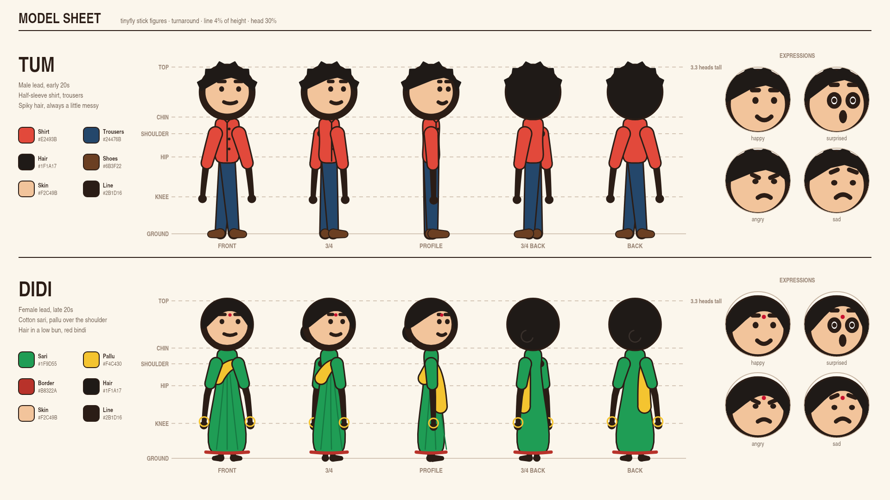
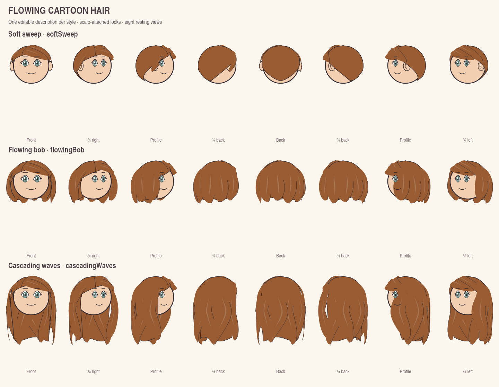
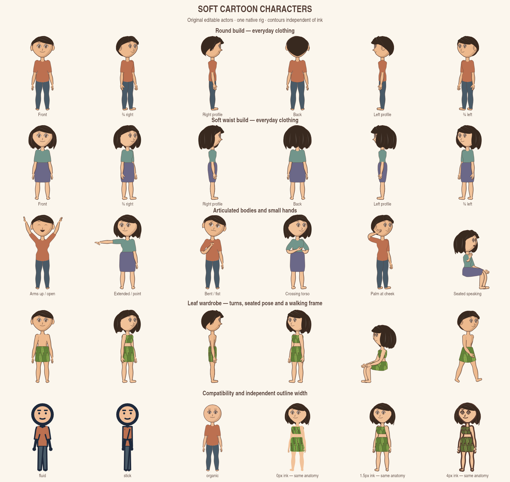
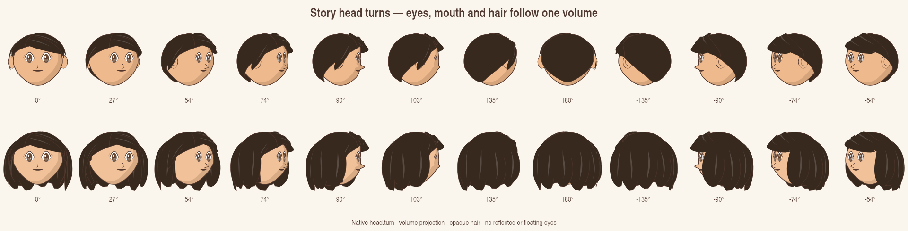
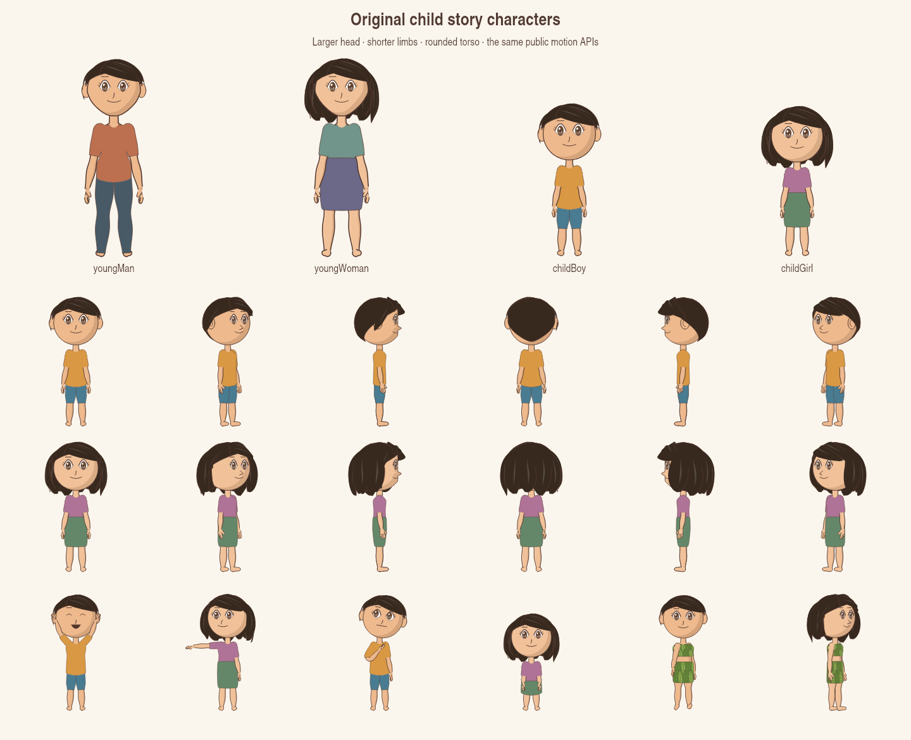
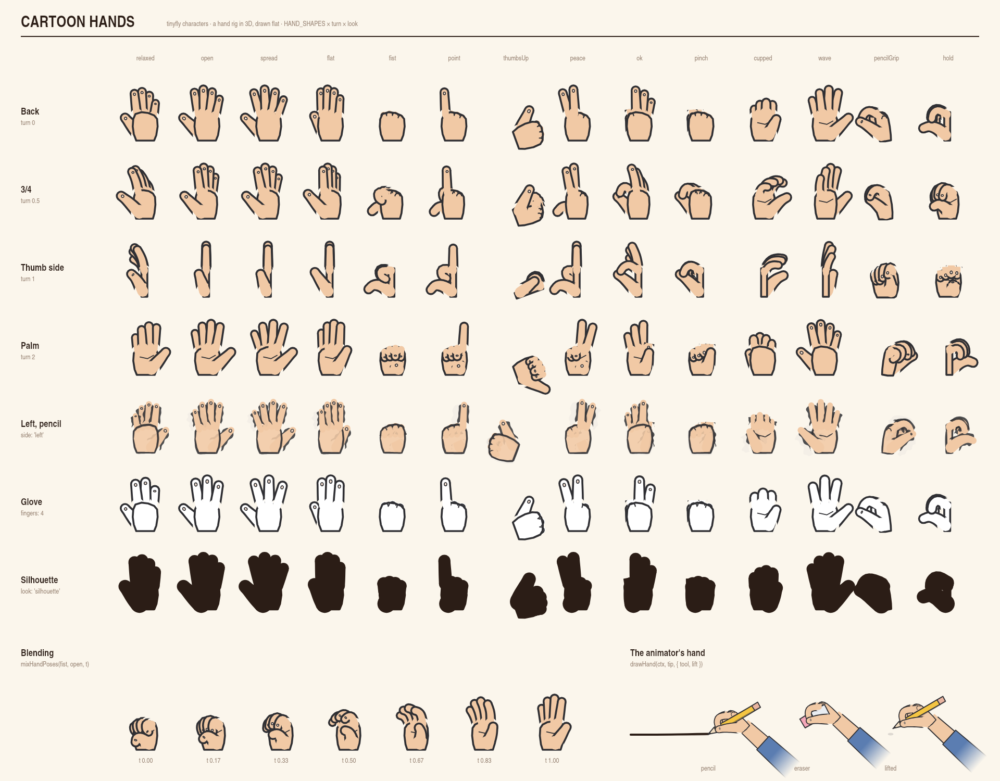
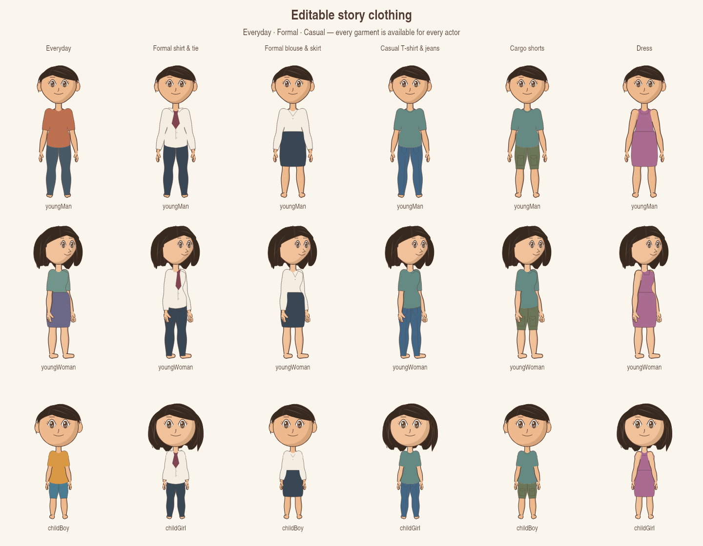

# Model sheet

A reference sheet for the stick-figure characters: how they are proportioned,
dressed and coloured, and how they look from every side. Use it to keep a cast
consistent across scenes and videos.



| | Tum | Didi |
|---|---|---|
| Role | Male lead, early 20s | Female lead, late 20s |
| Height | 360 px (3.3 heads) | 340 px (3.3 heads) |
| Clothes | Half-sleeve shirt, trousers, shoes | Cotton sari, pallu over the shoulder, bangles |
| Hair | Spiky, a little messy | Parted, low bun, red bindi |

Both use the bold look: line width 4% of the height (`lineWidth: height * 0.04`),
head 30% of the height (`headSize: 0.3`), `shoulderWidth: 0.07`, `rubber: 0.3`.

## The views

Each view is the same pose with a different `turn` and `facing`:

| View | `turn` | `facing` |
|---|---|---|
| Front | 0 | 1 |
| 3/4 | 0.5 | 1 |
| Profile | 1 | 1 |
| 3/4 back | 0.5 | -1 |
| Back | 0 | 1 |

The pose's arm and leg spread closes up as the figure turns: limb angles spread
sideways, and seen from the side a sideways spread would read as one arm
forward and one back. In the turned views the far arm sits behind the body (the
rig draws it before the torso once `turn` passes 0.25), and from the front the
feet turn out.

The figure has no back view of its own, since its face always shows. The
costume draws one: in the back views the `overHead` layer covers the whole head
with hair, and the clothes skip the front details (buttons, pleats) and hang the
pallu down the back.

## Regenerate

The sheet is drawn by code in
[`examples/headless-video/model-sheet.mjs`](../../examples/headless-video/model-sheet.mjs),
which also holds the costume, hair and palette code to copy into a scene:

```bash
npm run build:libs
npx tinyfly video examples/headless-video/model-sheet.mjs --stills stills/
cp stills/0-middle.png docs/model-sheet/model-sheet.png
```

See [Costumes, hair and props](../video-rendering.md#costumes-hair-and-props) for
`layers` and `stickFigureJoints()`.

## Flowing cartoon hair

Three original flowing styles, viewed from eight angles with the same options
in each view. Locks, colours and flexibility remain editable data; see
[character-appearance.md](../character-appearance.md).



Regenerate with
`npx tinyfly video examples/headless-video/flowing-hair-sheet.mjs --stills stills/`
after building the libraries, then copy `stills/0-middle.png` to
`docs/model-sheet/flowing-hair.png`.

## Soft cartoon story characters

Two original generic actors use the same human rig with `figure: 'organic'`.
Filled contours, skin and cel shading are independent of outline width.
The sheet includes six views, native hand gestures, seated speech, fitted
everyday and leaf garments, and the unchanged fluid/stick modes.



Close-ups check both eyes in three-quarter views, gradual far-eye occlusion,
the projected nose, and independent head turns in both directions:



Child boy/girl presets share the same rig, with larger head proportions,
shorter limbs, rounded torsos and smaller default heights. The child sheet
shows size beside adults, six views, gestures, seated speech and leaf clothing.



See [the appearance guide](../character-appearance.md) and the local
`/examples/live-organic-characters` example. Regenerate after building:

```bash
npx tinyfly video examples/headless-video/organic-characters.mjs --stills stills/
cp stills/0-middle.png docs/model-sheet/organic-characters.png
npx tinyfly video examples/headless-video/organic-story.mjs -o organic-story.mp4
npx tinyfly video examples/headless-video/organic-head-turns.mjs --stills heads/
cp heads/0-middle.png docs/model-sheet/organic-head-turns.png
npx tinyfly video examples/headless-video/child-characters.mjs --stills children/
cp children/0-middle.png docs/model-sheet/child-characters.png
```

## Hands

Every cartoon hand shape, turned and in every look: see
[cartoon-hands.md](../cartoon-hands.md).



## Editable clothing

Everyday, Formal and Casual outfits use the same adult and child rigs.
Shirts, blouses, dresses, jeans, cargo shorts and colours are plain options.



```sh
npx tinyfly video examples/headless-video/clothing-options.mjs --stills clothing/
cp clothing/0-middle.png docs/model-sheet/clothing-options.png
```

## Dance and flips

Every dance style's moves at their keys, and every flip from wind-up to landing
(orange while airborne): see [dance.md](../dance.md). Drawn by
[`examples/headless-video/dance-sheet.mjs`](../../examples/headless-video/dance-sheet.mjs).


